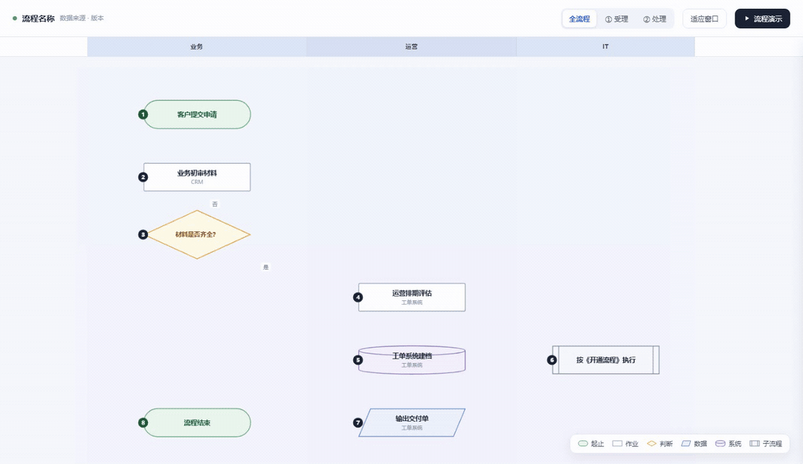
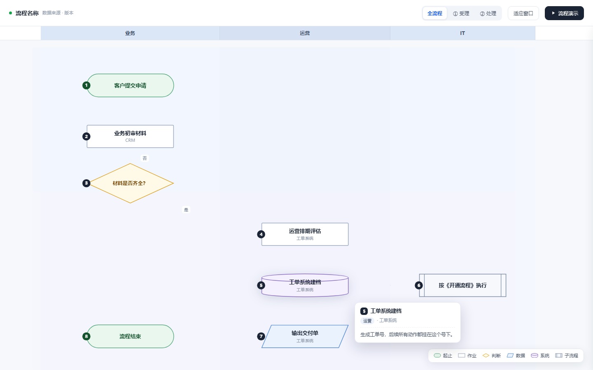
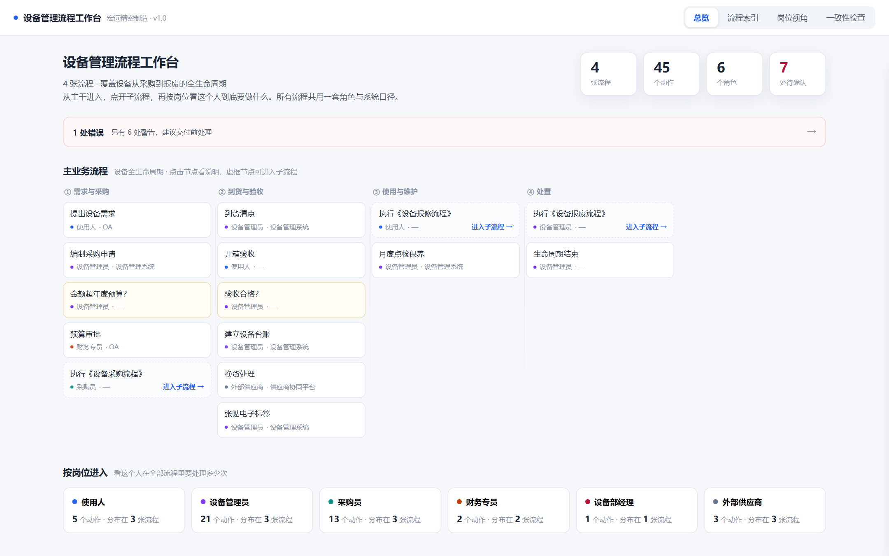
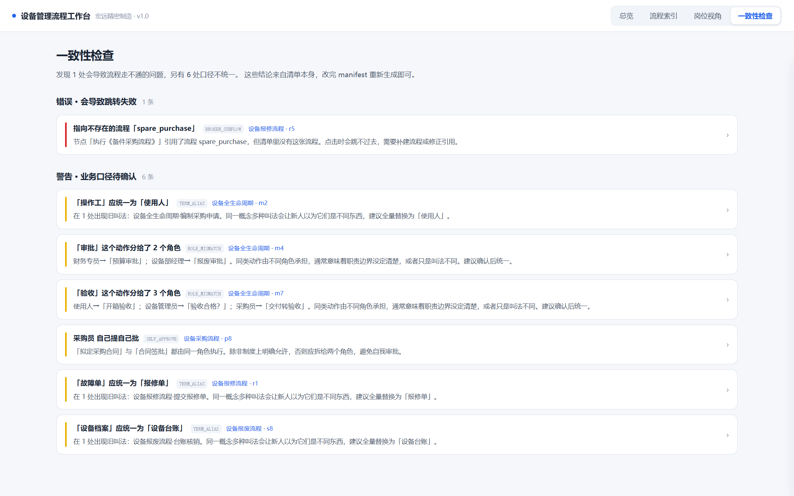

# dynamic-flow-diagram 动态流程图生成器

[](LICENSE)
[](https://github.com/qidian777/dynamic-flow-diagram/actions/workflows/validate.yml)
[](#安装)
[-green)](https://github.com/anthropics/skills)
[](#贡献)

**一个 Agent Skill：把 Visio / 文字描述的业务流程，变成单文件可交互的 HTML** ——
单图是动态流程图（标准图形、冻结泳道、阶段筛选、悬停说明、自动演示）；
v2 起支持**流程工作台**：全公司多张流程装进一个 HTML，总览、索引、跨流程跳转、岗位统计、一致性检查。专为**流程培训、评审汇报、岗位职责梳理、流程体系治理**设计。

> English below · [README (EN)](#english)



*悬停看说明 → 点击「流程演示」自动走完全程 —— 以上交互全部来自模板 `assets/template.html`，改数据即可用*

## 为什么做这个

流程图最大的浪费是「画完就死」：Visio 导出一张 PNG，培训时讲师对着静态图口述，学员不知道讲到哪、谁在做什么。

这个技能让 Agent 把流程**重建为可交互的单文件 HTML**：

| 传统静态图 | 本技能产物 |
|---|---|
| 讲师口述进度 | 「流程演示」自动逐步走完，当前步骤高亮 |
| 看不清谁负责什么 | 泳道按角色分列，标题冻结在顶部不随滚动消失 |
| 细节靠猜 | 悬停节点浮出说明，点击展开上下游，可跳转 |
| 看全图 vs 看局部矛盾 | 阶段标签一键聚焦，其余淡出 |
| 要装 Visio 才能看 | 单 HTML 双击即用，断网可用，< 40 KB |

所有交互细节都来自真实的返工反馈（7 轮迭代），沉淀为 **7 条铁律**，写进了 SKILL.md。

## 功能

- 📐 **标准流程图图形** —— 起止胶囊 / 作业矩形 / 判断菱形 / 数据平行四边形 / 系统圆柱 / 子流程双线矩形，与 Visio 母版一一对应
- 🧊 **冻结泳道条** —— Excel 冻结窗格式：标题固定顶部，横向跟随缩放平移
- 💬 **智能悬停气泡** —— 自动出现在节点左右两侧（绝不遮挡上下流程），与相邻节点重叠时自动寻找空档
- 🎬 **流程演示** —— 单步高亮 + 连线流动动画 + 进度提示，随时停止
- 👤 **岗位视角** —— 按角色筛选，一眼看清「某个人从头到尾要动几次手」
- 🔍 **三层信息架构** —— 扫一眼（气泡）→ 看单步（抽屉）→ 系统读（原文弹窗）
- 📦 **单文件交付** —— 无依赖、无 CDN、离线可用



### v2：流程工作台

单张图够用之后，公司真正的难点是**几十张流程各画各的**：子流程引用全靠口头、
同一个岗位散落在十几张图里、"客户/甲方/业主"三种叫法并存。工作台把所有流程
装进同一个 HTML：



- 🏠 **主流程总览** —— 价值流分列，虚框节点点进去就是子流程
- 🔎 **流程索引** —— 按名称或节点内容搜索，部门/角色/系统三筛选并联
- 🔗 **子流程串联** —— 跳到目标流程的指定节点并高亮，面包屑随时返回
- 👥 **岗位视角** —— "设备管理员在 3 张流程里要处理 21 次"，逐条可跳转
- 🩺 **一致性检查** —— 断链、术语不统一、自我审批，构建时自动体检



## 快速开始

### 方式一：作为 Agent Skill 使用（推荐）

兼容 [Agent Skills 格式](https://github.com/anthropics/skills)（Claude Code / WorkBuddy 等）：

```bash
# Claude Code：克隆到技能目录
git clone https://github.com/qidian777/dynamic-flow-diagram.git ~/.claude/skills/dynamic-flow-diagram

# WorkBuddy（Windows 示例，其他系统换成对应技能目录）
# 解压打包版到 ~/.workbuddy/skills/dynamic-flow-diagram/
```

然后对 Agent 说：

> 把这个 vsdx 里的采购流程做成动态流程图
> 按岗位看看客服在退货流程里要做哪几步
> 把这段流程说明做成能演示的网页，培训用

### 方式二：直接用模板

不想装 Skill？拿 `assets/template.html` 直接改数据层（第 1 节的 `PHASES / LANES / NODES / EDGES / SEQ` 五个常量），保存、刷新，就是你的流程图。

### 方式三：从 Visio 文件提取

```bash
python scripts/parse_vsdx.py 流程.vsdx           # 列出所有页
python scripts/parse_vsdx.py 流程.vsdx --page 4 -o page.json   # 导出某页
```

## 交付前自查

```bash
npm i playwright --no-save
node scripts/shot.js 你的流程图.html
```

自动截图 5 张（全图 / 单阶段 / 悬停 / 抽屉 / 演示），并检测：气泡是否遮挡节点、是否被窗口裁切、控制台报错、文件体积。**不看截图就交付 = 没做** —— 这是本技能的第一铁律。

## 目录结构

```
dynamic-flow-diagram/
├── SKILL.md                      # ★ 技能定义（含 7 条铁律）
├── references/
│   ├── layout-rules.md           # vsdx 解析、栅格参数、连线算法
│   ├── interaction-spec.md       # 交互清单、气泡避让实现、踩坑记录
│   └── qa-checklist.md           # 交付前验收清单
├── scripts/                      # ★ 随技能分发
│   ├── parse_vsdx.py             # .vsdx → JSON（形状/连线/文本）
│   ├── shot.js                   # Playwright 截图自查
│   └── validate_skill.py         # 技能包自检（CI 跑这个）
├── assets/
│   └── template.html             # 可直接改数据的工作骨架（含示例流程）
├── tools/                        # 仓库维护用，不进入发布包
│   ├── package.py                # 白名单打包 + 包内容校验
│   └── setup_repo_meta.py        # description / topics / Release 设置
├── dist/
│   └── dynamic-flow-diagram.zip  # 打包产物（技能市场 / 手动安装用）
└── docs/screenshots/             # 截图与演示 GIF（README 用绝对链接引用）
```

## 七条铁律（踩坑换来的）

1. **图形必须是标准流程图符号**，不能自创 —— 员工在 Visio/PPT 里认识这套语言
2. **浮层永远不许压住主内容** —— 悬停说明放左右侧，不放上下（上下是流程前进方向）
3. **信息分三层** —— 悬停看一句、点击看单步、弹窗读原文
4. **泳道标题要冻结** —— 像 Excel 冻结窗格
5. **坐标只写一份** —— DOM 与连线 SVG 都从数据层算
6. **中文排版按阅读习惯** —— 节点最多两行，超出拆节点而不是缩字号
7. **演示要能停下来** —— 培训时讲师随时会打断

完整展开见 [SKILL.md](SKILL.md)。

## 安装

| 方式 | 操作 |
|---|---|
| **Claude Code / 其他 Agent Skills 工具** | `git clone` 到技能目录（见[快速开始](#快速开始)），或下载 zip 解压进去 |
| **WorkBuddy 技能市场** | 添加技能 → 上传 zip → [下载 v2.0.0 dynamic-flow-diagram.zip](https://github.com/qidian777/dynamic-flow-diagram/releases/download/v2.0.0/dynamic-flow-diagram.zip)（含 SKILL.md / 模板 / 脚本，固定版本） |
| **只要模板看看** | 打开 [`assets/template.html`](assets/template.html)，复制源码即可，无需安装 |

> 上面是发行版（随 tag 固定，推荐）。想跟最新改动可用 [`main` 分支 zip](https://github.com/qidian777/dynamic-flow-diagram/raw/main/dist/dynamic-flow-diagram.zip)。
> 发布包由 `tools/package.py` 白名单构建，只含技能运行必需文件；维护脚本（`tools/`）、CI 配置与截图不进包。

## 适用 / 不适用

| ✅ 适用 | ❌ 不适用 |
|---|---|
| 流程培训、新人带教、评审汇报 | 需要真实系统联动的流程引擎 |
| Visio 老图交互化改造 | 只要一张静态配图 |
| 「谁在什么阶段做什么」梳理 | 架构图、思维导图、数据看板 |
| **多张流程的体系治理**：断链、术语统一、职责冲突检查 | 需要流程引擎执行/审批流 |

## English

**dynamic-flow-diagram** is an [Agent Skill](https://github.com/anthropics/skills) that turns business processes — from Visio `.vsdx`, screenshots, or plain text — into a **single-file interactive HTML flow diagram**: standard flowchart shapes (terminator, process, decision, data, database, subprocess), frozen swimlane headers, phase filters, smart hover notes that never block the flow, role-based filtering, and step-by-step playback for training sessions.

Quick start: clone into `~/.claude/skills/`, then ask your agent: *"Turn the procurement process in this .vsdx into an interactive diagram."* Or just edit the data section at the top of `assets/template.html`.

`scripts/parse_vsdx.py` parses `.vsdx` (it's a zip/OOXML) into JSON; `scripts/shot.js` takes Playwright screenshots and checks that overlays never cover nodes before you ship.

## 更新日志

**v2.2.0**（2026-11-07）
- 修复连线被泳道底色遮挡的层叠 bug（#wires 增加 z-index）——此前画布上节点可见但连线不可见
- 泳道支持非部门名称（如「业务部门」「招聘专员/HRBP」）：未登记泳道自动注册为外部泳道，
  保留原图泳道结构，不进部门筛选器
- 子流程定位到目标节点时自动放大到可读档位（此前大图 fitView 后跳转仍扁得看不清）
- 一致性检查降噪：兜底角色（如「销售部经办」）不参与自审批与职责分布判定；
  未接入图形的登记型流程不再报「子流程未指定入口」
- 已在 45 条真实企业流程（550 节点 / 481 连线）上回归验证

**v2.1.0**（2026-11-05）
- 泳道支持两种口径：岗位（v2.0 写法）或**部门**（v2.1 新增），两套字典都认，部门泳道企业直接可用
- 新增 `registry: true` 流程：手册登记但暂无图形的流程只进索引与筛选，画布给出"未接入图形"说明页
- 布局引擎防重叠加固：同泳道同层多节点按实际高度顺延，45 节点真实流程零重叠
- 一致性检查·自我审批改为沿连线两跳判定并去重，消除顺序无关节点的误报
- 已在 43 条真实企业流程（250 节点）上回归验证

**v2.0.0**（2026-11-05）工作台模式
- 新增：**流程工作台** —— 把全公司多张流程装进一个 HTML，五个视图：主流程总览、流程索引（搜索 + 按部门/角色/系统筛选）、跨流程岗位统计、一致性检查报告
- 新增：**子流程串联** —— 点击子流程节点跳到目标流程的指定节点，面包屑返回，可一路点下去
- 新增：**一致性检查器** —— 断链（引用不存在的流程/节点）、术语不统一（别名声明式检查）、职责冲突（自我审批、同类动作跨流程角色不一致）
- 新增：**自动布局** —— manifest 里不写坐标，拓扑分层 + 泳道定列自动排布；回边（如"换货后重新到货"）安全处理
- 新增：`examples/demo-manifest.yaml` 虚构示例（4 张流程 45 个节点，故意埋了 3 处问题当检查器测试用例）
- 新增：`scripts/build_workbench.py`（校验/检查/构建）、`scripts/shot_workbench.js`（七图断言自查）、`references/workbench-spec.md`
- 单图模式原样保留，两种模式按场景选择

**v1.0.1**（2026-11-04）
- 修复：`v1.0.0` 的 tag 原本指向首个提交，其中 README 仍含仓库名占位符（照抄 clone 命令会失败）、`.gitignore` 为旧版 —— v1.0.1 从修复后的提交重新打 tag
- 修复：一次性运维脚本 `setup_repo_meta.py` 被打进发布包，现已移到 `tools/` 并不再入包
- 修复：发布包内 README 与 `main` 不一致；现由 `tools/package.py` 统一构建并自校验
- 修复：包内不含截图导致 README 图片不显示；图片改为绝对链接
- 新增：README 顶部演示 GIF
- 发布包构成：`SKILL.md` / `README.md` / `LICENSE` / `assets/` / `references/` ×3 / `scripts/` ×3，共 10 个文件

**v1.0.0**（2026-11-03）首版：七条铁律 + 模板骨架 + vsdx 解析 + 截图自查

## 贡献

欢迎 PR：新的图形类型、更好的连线避障、其他格式解析（draw.io / PlantUML / Axure）。

## License

[MIT](LICENSE) © 施鸿雁（美美虾-阿羽）
