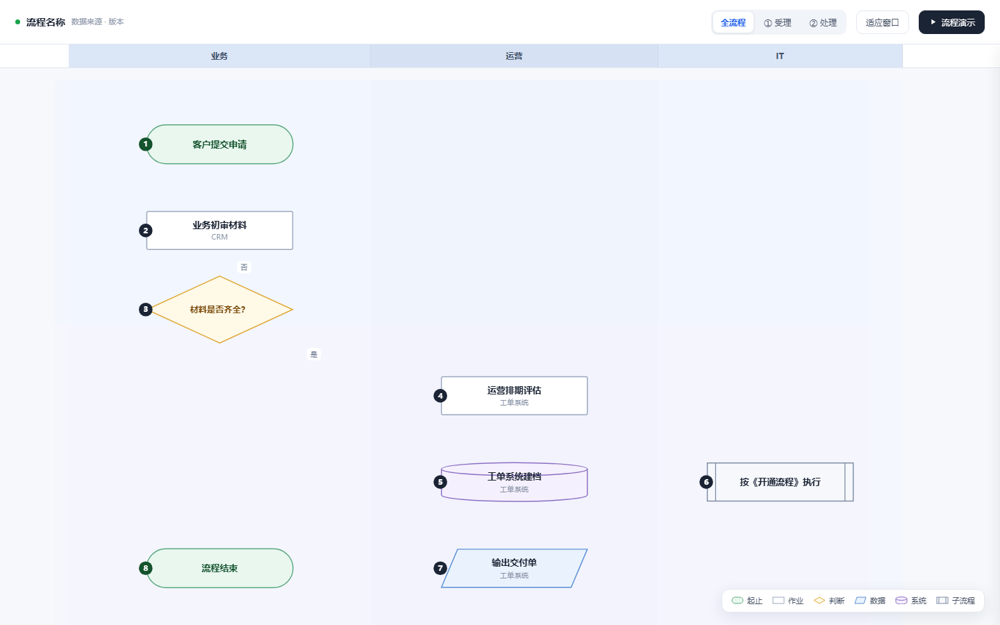

# dynamic-flow-diagram 动态流程图生成器

[](LICENSE)
[](https://github.com/qidian777/dynamic-flow-diagram/actions/workflows/validate.yml)
[](#安装)
[-green)](https://github.com/anthropics/skills)
[](#贡献)

**一个 Agent Skill：把 Visio / 文字描述的业务流程，变成单文件可交互的 HTML 动态流程图** —— 标准流程图图形、冻结泳道、阶段筛选、悬停说明、自动演示。专为**流程培训、评审汇报、岗位职责梳理**设计。

> English below · [README (EN)](#english)



## 为什么做这个

流程图最大的浪费是「画完就死」：Visio 导出一张 PNG，培训时讲师对着静态图口述，学员不知道讲到哪、谁在做什么。

这个技能让 Agent 把流程**重建为可交互的单文件 HTML**：

| 传统静态图 | 本技能产物 |
|---|---|
| 讲师口述进度 | 「流程演示」自动逐步走完，当前步骤高亮 |
| 看不清谁负责什么 | 泳道按角色分列，标题冻结在顶部不随滚动消失 |
| 细节靠猜 | 悬停节点浮出说明，点击展开上下游，可跳转 |
| 看全图 vs 看局部矛盾 | 阶段标签一键聚焦，其余淡出 |
| 要装 Visio 才能看 | 单 HTML 双击即用，断网可用，< 40 KB |

所有交互细节都来自真实的返工反馈（7 轮迭代），沉淀为 **7 条铁律**，写进了 SKILL.md。

## 功能

- 📐 **标准流程图图形** —— 起止胶囊 / 作业矩形 / 判断菱形 / 数据平行四边形 / 系统圆柱 / 子流程双线矩形，与 Visio 母版一一对应
- 🧊 **冻结泳道条** —— Excel 冻结窗格式：标题固定顶部，横向跟随缩放平移
- 💬 **智能悬停气泡** —— 自动出现在节点左右两侧（绝不遮挡上下流程），与相邻节点重叠时自动寻找空档
- 🎬 **流程演示** —— 单步高亮 + 连线流动动画 + 进度提示，随时停止
- 👤 **岗位视角** —— 按角色筛选，一眼看清「某个人从头到尾要动几次手」
- 🔍 **三层信息架构** —— 扫一眼（气泡）→ 看单步（抽屉）→ 系统读（原文弹窗）
- 📦 **单文件交付** —— 无依赖、无 CDN、离线可用


## 快速开始

### 方式一：作为 Agent Skill 使用（推荐）

兼容 [Agent Skills 格式](https://github.com/anthropics/skills)（Claude Code / WorkBuddy 等）：

```bash
# Claude Code：克隆到技能目录
git clone https://github.com/<your-name>/dynamic-flow-diagram.git ~/.claude/skills/dynamic-flow-diagram
```

然后对 Agent 说：

> 把这个 vsdx 里的采购流程做成动态流程图
> 按岗位看看客服在退货流程里要做哪几步
> 把这段流程说明做成能演示的网页，培训用

### 方式二：直接用模板

不想装 Skill？拿 `assets/template.html` 直接改数据层（第 1 节的 `PHASES / LANES / NODES / EDGES / SEQ` 五个常量），保存、刷新，就是你的流程图。

### 方式三：从 Visio 文件提取

```bash
python scripts/parse_vsdx.py 流程.vsdx           # 列出所有页
python scripts/parse_vsdx.py 流程.vsdx --page 4 -o page.json   # 导出某页
```

## 交付前自查

```bash
npm i playwright --no-save
node scripts/shot.js 你的流程图.html
```

自动截图 5 张（全图 / 单阶段 / 悬停 / 抽屉 / 演示），并检测：气泡是否遮挡节点、是否被窗口裁切、控制台报错、文件体积。**不看截图就交付 = 没做** —— 这是本技能的第一铁律。

## 目录结构

```
dynamic-flow-diagram/
├── SKILL.md                      # ★ 技能定义（含 7 条铁律）
├── references/
│   ├── layout-rules.md           # vsdx 解析、栅格参数、连线算法
│   ├── interaction-spec.md       # 交互清单、气泡避让实现、踩坑记录
│   └── qa-checklist.md           # 交付前验收清单
├── scripts/
│   ├── parse_vsdx.py             # .vsdx → JSON（形状/连线/文本）
│   ├── shot.js                   # Playwright 截图自查
│   └── validate_skill.py         # 技能包自检（CI 跑这个）
├── assets/
│   └── template.html             # 可直接改数据的工作骨架（含示例流程）
└── docs/screenshots/             # 截图
```

## 七条铁律（踩坑换来的）

1. **图形必须是标准流程图符号**，不能自创 —— 员工在 Visio/PPT 里认识这套语言
2. **浮层永远不许压住主内容** —— 悬停说明放左右侧，不放上下（上下是流程前进方向）
3. **信息分三层** —— 悬停看一句、点击看单步、弹窗读原文
4. **泳道标题要冻结** —— 像 Excel 冻结窗格
5. **坐标只写一份** —— DOM 与连线 SVG 都从数据层算
6. **中文排版按阅读习惯** —— 节点最多两行，超出拆节点而不是缩字号
7. **演示要能停下来** —— 培训时讲师随时会打断

完整展开见 [SKILL.md](SKILL.md)。

## 安装

- **WorkBuddy**：技能市场 → 添加技能 → 上传 `dynamic-flow-diagram.zip`（[Releases](../../releases) 下载）
- **Claude Code**：`git clone` 到 `~/.claude/skills/`
- **其他兼容 Agent Skills 的工具**：把目录放入对应技能目录即可

## 适用 / 不适用

| ✅ 适用 | ❌ 不适用 |
|---|---|
| 流程培训、新人带教、评审汇报 | 需要真实系统联动的流程引擎 |
| Visio 老图交互化改造 | 只要一张静态配图 |
| 「谁在什么阶段做什么」梳理 | 架构图、思维导图、数据看板 |

## English

**dynamic-flow-diagram** is an [Agent Skill](https://github.com/anthropics/skills) that turns business processes — from Visio `.vsdx`, screenshots, or plain text — into a **single-file interactive HTML flow diagram**: standard flowchart shapes (terminator, process, decision, data, database, subprocess), frozen swimlane headers, phase filters, smart hover notes that never block the flow, role-based filtering, and step-by-step playback for training sessions.

Quick start: clone into `~/.claude/skills/`, then ask your agent: *"Turn the procurement process in this .vsdx into an interactive diagram."* Or just edit the data section at the top of `assets/template.html`.

`scripts/parse_vsdx.py` parses `.vsdx` (it's a zip/OOXML) into JSON; `scripts/shot.js` takes Playwright screenshots and checks that overlays never cover nodes before you ship.

## 贡献

欢迎 PR：新的图形类型、更好的连线避障、其他格式解析（draw.io / PlantUML / Axure）。

## License

[MIT](LICENSE) © 施鸿雁（美美虾-阿羽）
